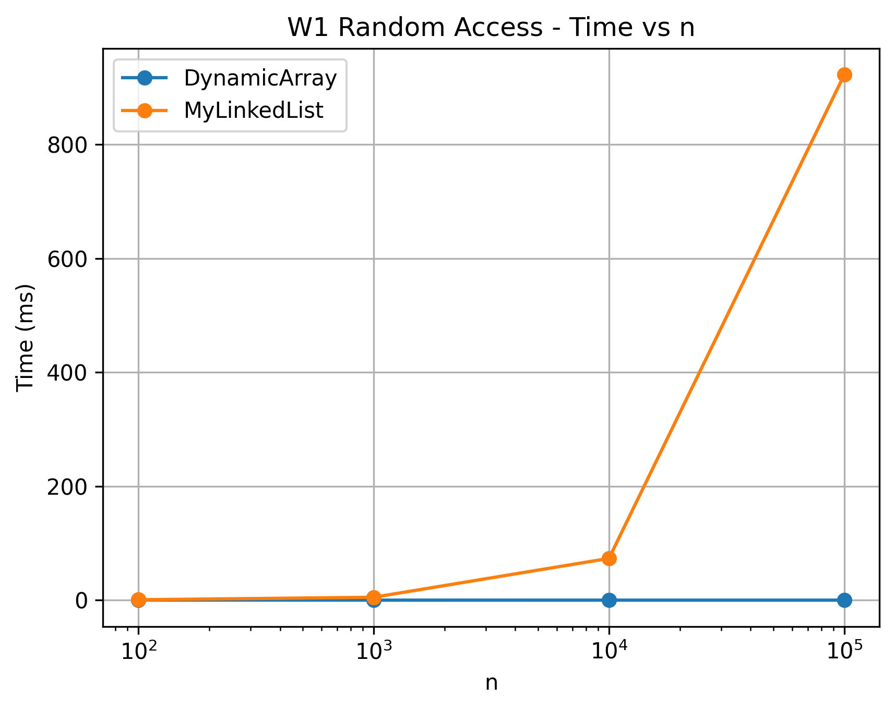
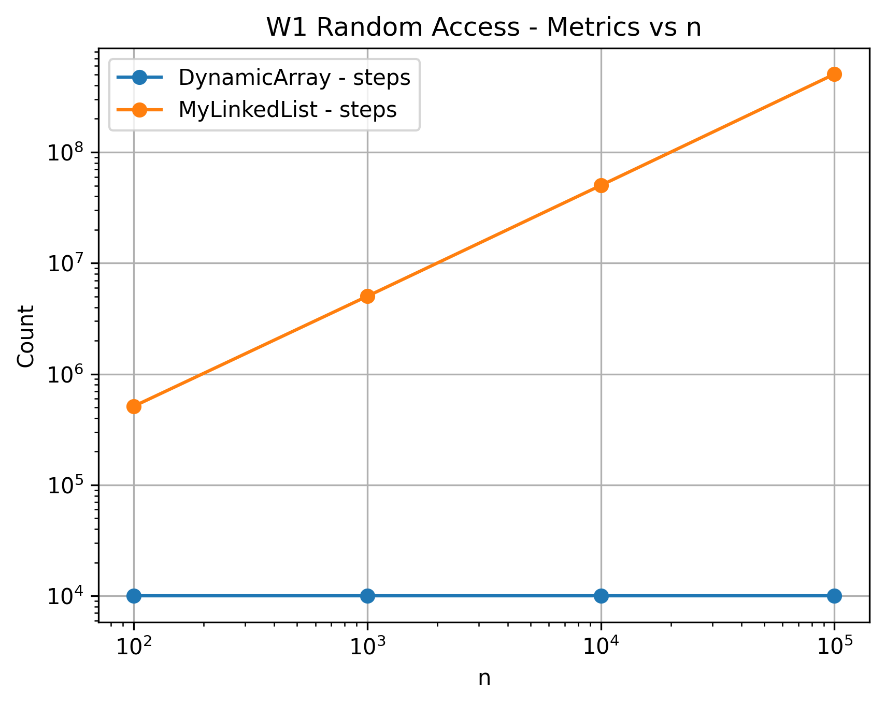
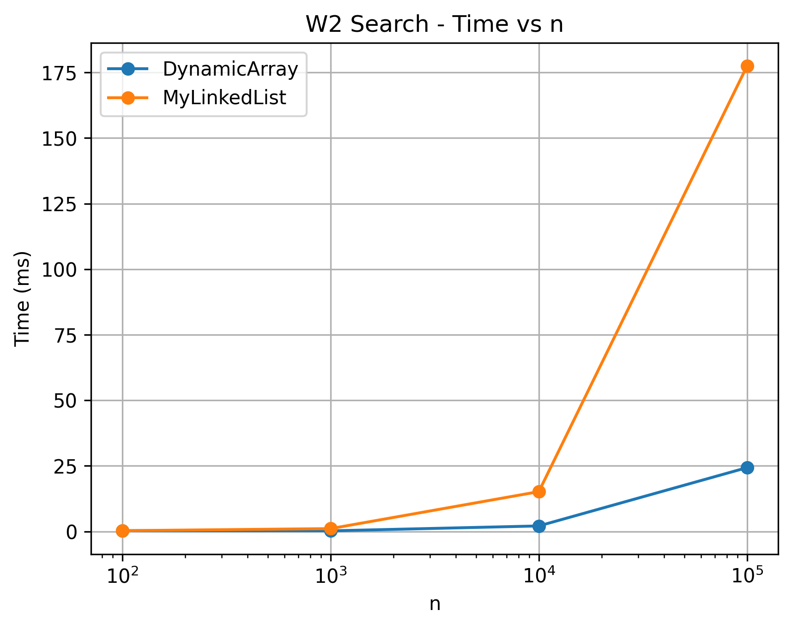
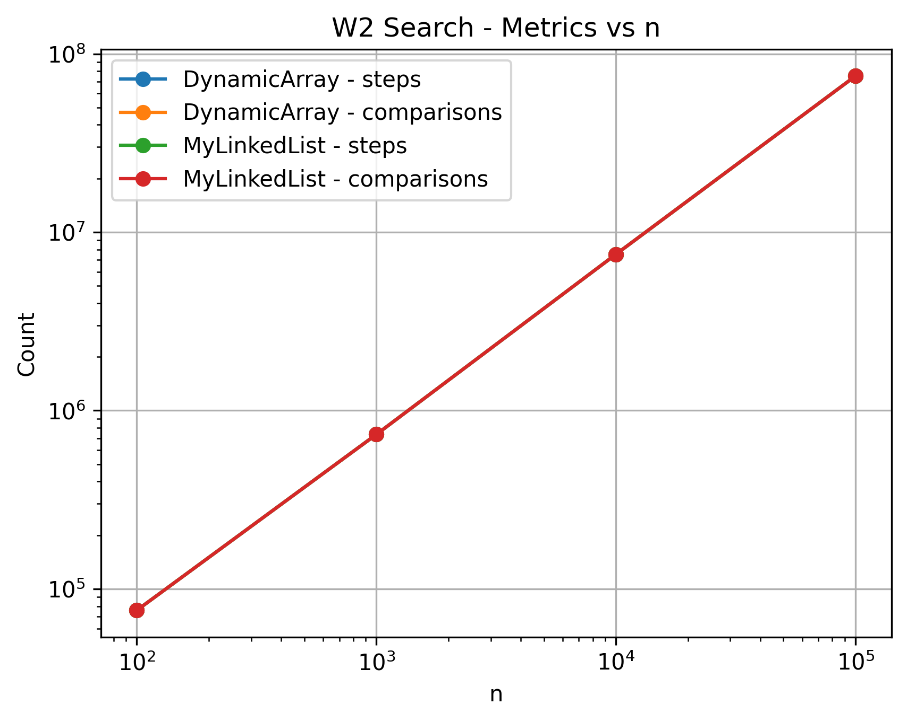
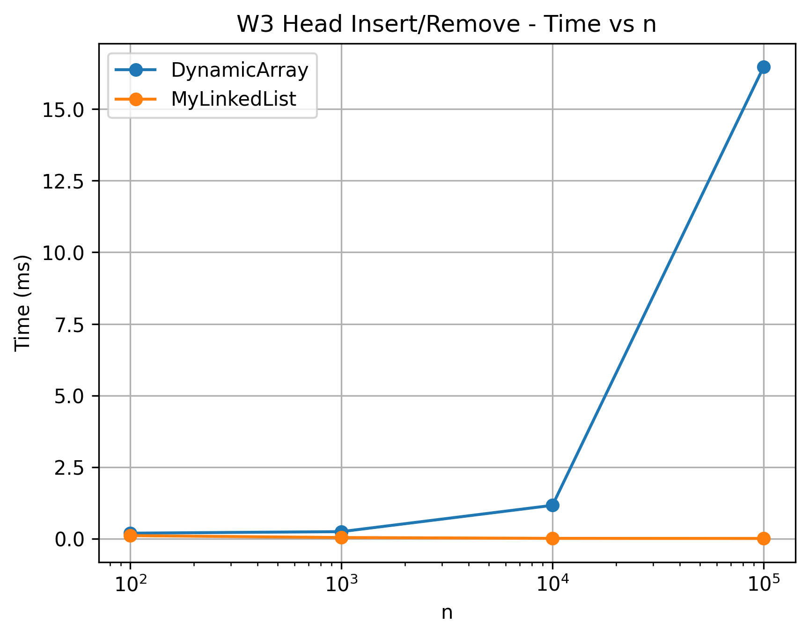
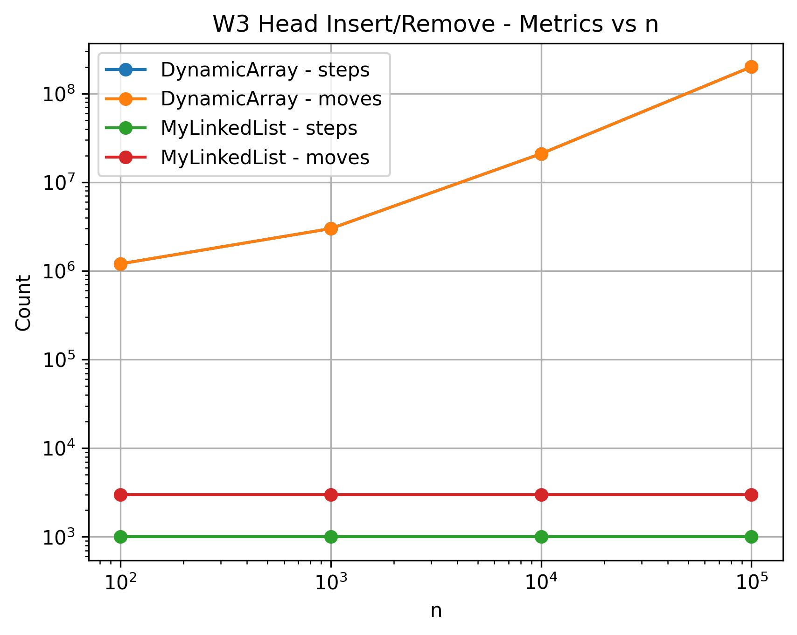
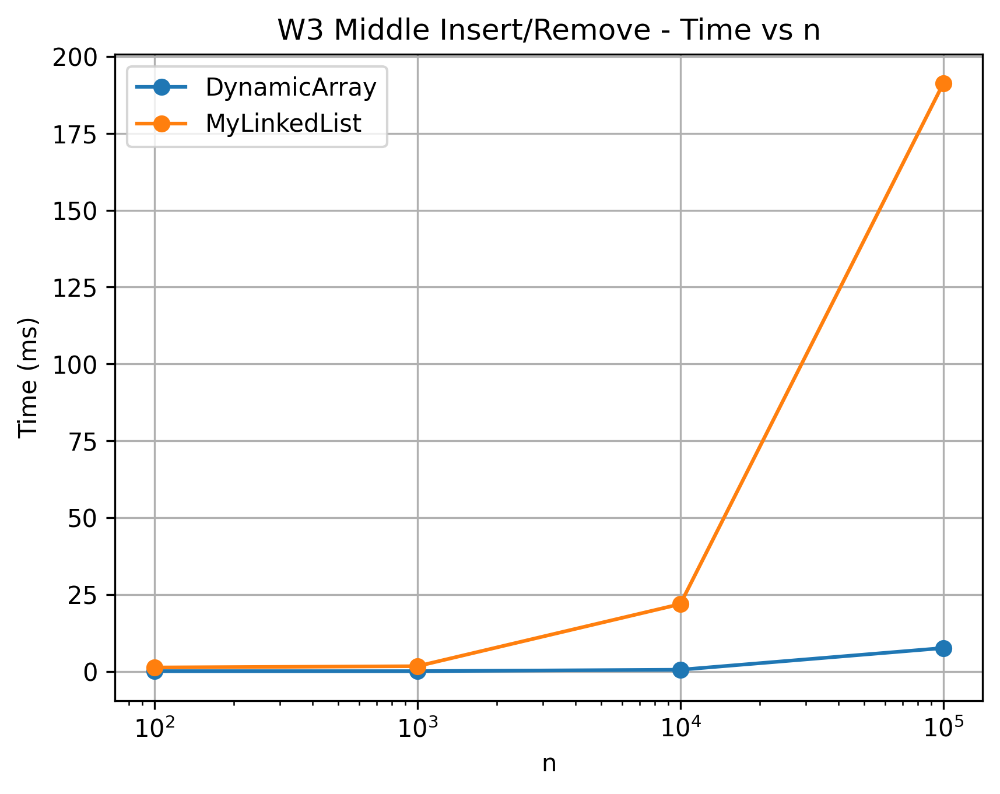
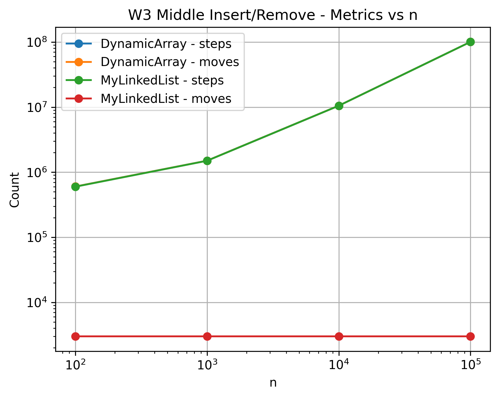
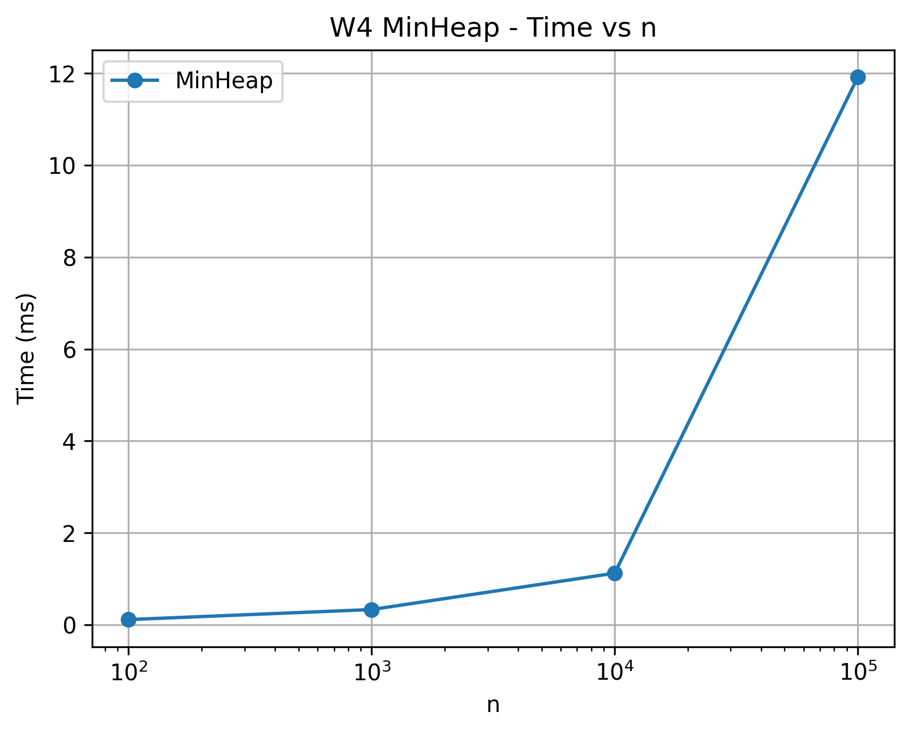
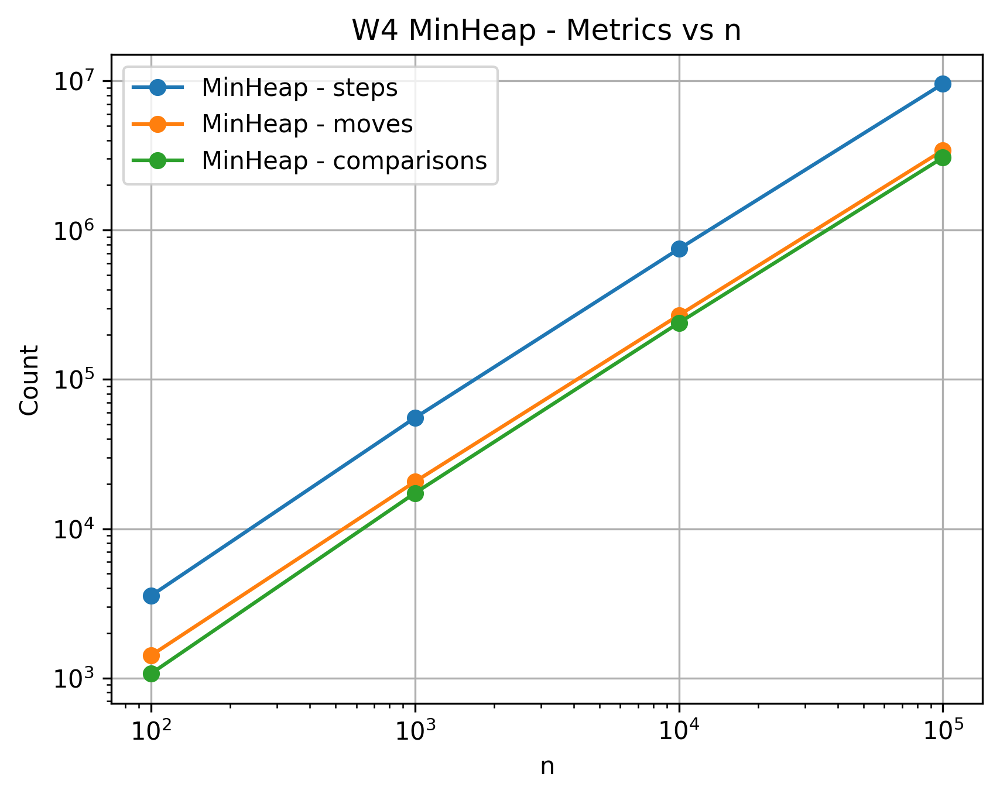

# Assignment 2 Report
## Dynamic Array, Linked List and Min-Heap

**Student:** Talshyn Otegen  
**Course:** Design and Analysis of Algorithms

# 1. Introduction

The purpose of this assignment is to implement and experimentally analyze three data structures from scratch:

DynamicArray

MyLinkedList

MinHeap

The implementations use primitive int values.

Java built-in implementations such as ArrayList, LinkedList, and PriorityQueue are not used for the main data structures.

The project also measures physical operations using three counters:

steps – array cell access or movement to another linked-list node.

moves – array element movement or link/pointer update.

comparisons – comparison between two elements.

The experimental part contains four workloads.

The following input sizes are used:

100

1000

10000

100000

Random data is generated using Random(42).

This makes the experiments reproducible.

# 2. Implemented Data Structures

## 2.1 DynamicArray

DynamicArray stores integers inside an array.

The initial capacity is 10.

When the internal array becomes full, the grow() method is used.

The grow() method creates a new array.

The new array has twice the previous capacity.

Existing elements are copied into the new array.

The following operations are implemented:

add(x)

add(index, x)

remove(index)

get(index)

contains(x)

size()

Random access is efficient in DynamicArray.

An element can be accessed directly using its index.

Insertion at the beginning or middle can be expensive.

Removal at the beginning or middle can also be expensive.

This happens because elements must be shifted.

## 2.2 MyLinkedList

MyLinkedList is implemented using nodes.

Each node contains an integer value.

Each node also contains a reference to the next node.

The following operations are implemented:

add(x)

add(index, x)

remove(index)

get(index)

contains(x)

size()

Accessing an element by index requires traversal from the head.

The algorithm moves from one node to the next node.

Insertion at the head does not require shifting elements.

Removal at the head also does not require shifting elements.

Only references need to be changed.

## 2.3 MinHeap

MinHeap is implemented using an integer array.

The minimum element is stored at index 0.

The parent index is calculated as:

(i - 1) / 2

The left child index is calculated as:

2 * i + 1

The right child index is calculated as:

2 * i + 2

Insertion uses the bubble-up operation.

Bubble-up restores the heap property after insertion.

Extraction uses the bubble-down operation.

Bubble-down restores the heap property after removing the minimum element.

The internal array grows when it becomes full.

Its capacity is doubled during growth.

# 3. Complexity Analysis

The following table shows the theoretical complexity of the implemented operations.

| Structure | Operation | Best Case | Average Case | Worst Case | Auxiliary Space |
|---|---|---|---|---|---|
| DynamicArray | add(x) | Ω(1) | Θ(1) amortized | O(n) | O(n) during growth |
| DynamicArray | add(index, x) | Ω(1) | Θ(n) | O(n) | O(n) during growth |
| DynamicArray | remove(index) | Ω(1) | Θ(n) | O(n) | O(1) |
| DynamicArray | get(index) | Ω(1) | Θ(1) | O(1) | O(1) |
| DynamicArray | contains(x) | Ω(1) | Θ(n) | O(n) | O(1) |
| MyLinkedList | add(x) | Ω(1) | Θ(n) | O(n) | O(1) |
| MyLinkedList | add(index, x) | Ω(1) | Θ(n) | O(n) | O(1) |
| MyLinkedList | remove(index) | Ω(1) | Θ(n) | O(n) | O(1) |
| MyLinkedList | get(index) | Ω(1) | Θ(n) | O(n) | O(1) |
| MyLinkedList | contains(x) | Ω(1) | Θ(n) | O(n) | O(1) |
| MinHeap | insert(x) | Ω(1) | O(log n) | O(log n) | O(n) during growth |
| MinHeap | peekMin() | Ω(1) | Θ(1) | O(1) | O(1) |
| MinHeap | extractMin() | Ω(1) | O(log n) | O(log n) | O(1) |

## Complexity Justification

DynamicArray get(index) has constant complexity.

Array indexing gives direct access to an element.

DynamicArray contains(x) may find the required value immediately.

Therefore, its best case is Ω(1).

In the average and worst cases, it checks many or all elements.

Therefore, its linear complexity is Θ(n) on average and O(n) in the worst case.

Insertion and removal near the beginning of DynamicArray require shifting elements.

Therefore, these operations can take linear time.

DynamicArray add(x) is Θ(1) amortized.

Most append operations take constant time.

Sometimes the array must grow and existing elements must be copied.

MyLinkedList does not provide direct random access.

To reach a specific index, the algorithm follows references from the head.

Therefore, get(index) has linear average and worst-case complexity.

Insertion or removal at index 0 does not require traversal.

Therefore, the best case can be Ω(1).

MinHeap peekMin() is Θ(1).

The minimum element is always stored at index 0.

MinHeap insert(x) can use bubble-up.

MinHeap extractMin() can use bubble-down.

The height of a binary heap is logarithmic.

Therefore, insert and extractMin have O(log n) worst-case complexity.

# 4. Loop Invariant Proofs

## 4.1 DynamicArray contains(x)

The contains(x) method checks the elements from left to right.

### Invariant

At the beginning of iteration i, none of the elements from index 0 to i - 1 is equal to x.

### Initialization

Before the first iteration, no elements have been checked.

Therefore, the invariant is true.

### Maintenance

During iteration i, the algorithm compares data[i] with x.

If data[i] is equal to x, the method returns true.

If data[i] is not equal to x, the algorithm continues to the next element.

All previously checked elements are not equal to x.

Therefore, the invariant remains true.

### Termination

The loop stops when x is found or when all elements have been checked.

### Conclusion

If x is found, the method correctly returns true.

If the loop finishes without finding x, all elements have been checked.

Therefore, the method correctly returns false.

## 4.2 MinHeap bubbleUp

The bubbleUp method restores the min-heap property after insertion.

### Invariant

At the beginning of each iteration, the heap property is correct everywhere except possibly between the current element and its parent.

### Initialization

Before bubbleUp starts, the existing heap already satisfies the min-heap property.

A new element is inserted at the end of the heap.

Only the new element can violate the heap property with its parent.

Therefore, the invariant is true.

### Maintenance

The current element is compared with its parent.

If the parent is smaller than or equal to the current element, the loop stops.

The heap property is correct.

If the current element is smaller than its parent, the two elements are swapped.

The current element then moves to the parent position.

A possible violation can now exist only between the current element and its new parent.

Therefore, the invariant remains true.

### Termination

The loop terminates when the current element reaches the root or when its parent is smaller than or equal to it.

### Conclusion

When the loop terminates, there is no parent-child violation.

Therefore, the min-heap property is restored.

# 5. Experimental Method

The benchmark was used to compare the practical performance of the implemented data structures.

The following input sizes were used:

100

1000

10000

100000

Random data was generated using Random(42).

This makes the experiments reproducible.

Each benchmark case included one warm-up run.

The warm-up result was discarded.

After the warm-up, each case was measured five times.

The median execution time was saved.

Execution time was measured in milliseconds.

The physical operations were measured using steps, moves, and comparisons.

The results were saved in:

results/results.csv

## 5.1 W1 – Random Access

W1 tests random access.

DynamicArray and MyLinkedList were compared.

Each structure was filled with n elements.

Then 10,000 random get(index) operations were performed.

The same random indexes were used for both structures.

## 5.2 W2 – Search

W2 tests the contains(x) operation.

DynamicArray and MyLinkedList were compared.

1,000 search operations were performed.

500 searched values were present in the structure.

500 searched values were absent from the structure.

## 5.3 W3 – Insert and Remove

W3 tests insertion and removal.

DynamicArray and MyLinkedList were compared.

1,000 insertions were performed.

Then 1,000 removals were performed.

Two variants were tested:

head

middle

For the head variant, operations were performed at index 0.

For the middle variant, operations were performed near the middle of the structure.

## 5.4 W4 – Priority Processing

W4 tests MinHeap.

n random values were inserted into the heap.

After insertion, all values were extracted using extractMin().

The extracted values were checked.

They had to be in nondecreasing order.

This verifies that the MinHeap works correctly.

## 5.5 Collected Metrics

The following metrics were collected:

time_ms

steps

moves

comparisons

The CSV file uses the following columns:

workload

variant

structure

n

time_ms

steps

moves

comparisons

# 6. Experimental Results

## 6.1 W1 – Random Access

DynamicArray was significantly faster than MyLinkedList for random access.

At n = 100000, DynamicArray required approximately 0.0052 ms.

MyLinkedList required approximately 922.5644 ms.

DynamicArray performed 10,000 steps.

MyLinkedList performed 505,028,648 steps.

DynamicArray can directly access an element by its index.

MyLinkedList must move through nodes from the head.

Therefore, the performance difference becomes larger when n increases.

## 6.2 W2 – Search

Both DynamicArray and MyLinkedList use linear search.

At n = 100000, DynamicArray required approximately 24.3349 ms.

MyLinkedList required approximately 177.4533 ms.

Both structures performed 75,177,945 comparisons.

Their theoretical search complexity is similar.

However, DynamicArray was faster in practice because its elements are stored contiguously in memory.

## 6.3 W3 – Head Insert and Remove

MyLinkedList was faster for operations at the head.

At n = 100000, DynamicArray required approximately 16.4724 ms.

MyLinkedList required approximately 0.0060 ms.

DynamicArray performed 201,000,000 moves.

This happens because array elements must be shifted during head insertion and removal.

MyLinkedList does not shift all elements.

It only changes references between nodes.

## 6.4 W3 – Middle Insert and Remove

Middle operations require significant work for both structures.

At n = 100000, DynamicArray required approximately 7.6797 ms.

MyLinkedList required approximately 191.1726 ms.

DynamicArray performed 100,500,500 moves.

MyLinkedList performed 100,498,500 steps.

DynamicArray must shift elements around the middle position.

MyLinkedList must traverse nodes to reach the middle position.

In this experiment, DynamicArray was faster.

## 6.5 W4 – MinHeap

MinHeap execution time increased as n increased.

At n = 100000, the workload required approximately 11.9174 ms.

The workload recorded 9,539,950 steps.

It recorded 3,421,384 moves.

It recorded 3,059,283 comparisons.

All extracted values were checked to be in nondecreasing order.

This confirms that the MinHeap maintained the correct heap property during the workload.

# 7. Discussion

DynamicArray performs very well for random access because its elements are stored in contiguous memory.

Contiguous memory provides good spatial locality.

Modern processors load nearby data into cache lines, so array operations can benefit from the CPU cache.

MyLinkedList stores data inside separate Node objects.

These nodes may be located in different areas of memory.

Therefore, linked-list traversal requires pointer chasing from one node to another.

Pointer chasing can cause more cache misses and make MyLinkedList slower.

Each Node also requires additional memory for its object header and next reference.

Creating many Node objects can also increase memory allocation and garbage collection pressure.

DynamicArray uses less memory per element because primitive integers are stored directly inside one array.

However, DynamicArray is inefficient for frequent insertion and removal at the head because many elements must be shifted.

MyLinkedList is better when frequent insertion or removal is required at the head.

DynamicArray is better when frequent random access by index is required.

MinHeap is better when an application frequently needs to access and remove the smallest element.

The experimental results show that practical performance depends on both algorithmic complexity and memory organization.

# 8. Conclusion

This assignment compared DynamicArray, MyLinkedList, and MinHeap.

DynamicArray provides fast random access.

However, insertion and removal can require many element shifts.

MyLinkedList does not require element shifting.

It is especially efficient for insertion and removal at the head.

However, random access is slow because nodes must be traversed one by one.

MinHeap efficiently supports priority processing.

The minimum element can be accessed directly from the root.

Insert and extractMin operations use bubble-up and bubble-down to maintain the heap property.

The experimental results generally agree with the theoretical complexity analysis.

The results also show that real performance depends on memory layout, cache locality, pointer traversal, and the number of physical operations.

Therefore, the best data structure depends on the operations required by a particular problem.